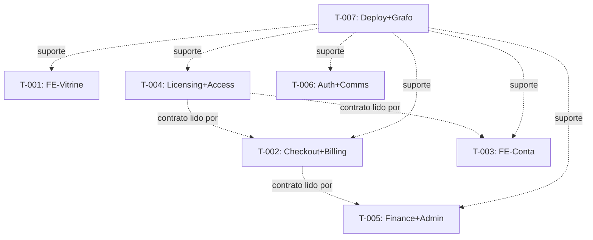

# TASK-PLAN v2 — 7 especialistas por ponta (grafo total 812 nós)

project: Aurum Bit
plan_id: specialists-2026-10-14
plan_version: 1.0.0
canonical_source: .planning/TASK-PLAN.md
dashboard_target: TASK-DASHBOARD.html
status: ready
owner_role: planner
created_at: 2026-10-14
updated_at: 2026-10-14

## Feature Layer

feature_id: SPEC-7PONTAS
feature_title: Cobertura ponta a ponta por 7 especialistas (landpage → deploy)
rationale: Grafo knowledge-v2 agora indexa tudo (812 nós / 1028 arestas); cada ponta crítica ganha um dono com escopo, verificação e rollback fechados.
priority: P1
status: ready
goal: Auditar e endurecer as 7 pontas sem regressão; nenhuma prova silenciosa, nenhum mock quieto em prod-path.
scope_in:
- Landpage `/`, checkout, dashboard portal, billing/licensing/finance backend, auth/comms, admin ops, deploy + grafo
scope_out:
- Fase 9 (app_<slug>), Fase 10 (sync), redesign visual, qualquer mutação em produção/VPS
changed_subsystems:
- apps/portal, apps/admin, apps/api, apps/workers, libs, prisma, deploy, docs/knowledge-v2
constraints:
- DEV-ONLY para knowledge-v2 (só escreve em docs/knowledge-v2/data/)
- Sem commit de .env/.env.prod; sem segredo em log; sem push sem pedido
- BFF sem upstream = 502 fail-closed, nunca mock silencioso
assumptions:
- Lanes paralelas só leitura de contrato entre si; escrita restrita a candidate_files da lane
open_questions:
- VPS ceremony (Fases 7-8) continua pendente — fora deste plano (ver A-OPS-001)
risks:
- 7 lanes paralelas tocam arquivos vizinhos (portal/*) — mitigado por candidate_files disjuntos
regression_risks:
- Copy/SEO da landpage, regra sem-done-sem-cobrança, idempotência webhook, offline/channel gating
security_privacy_notes:
- Chaves só keyMasked; reveal com MFA+audit; finance.read default-deny; IP só hash; LGPD/GDPR preservados
non_functional_requirements:
- LCP landpage preservado; ack webhook Asaas < 2s; check-access cache 60s com channel na chave
milestones:
- M1: 7 auditorias entregues com evidência executada
- M2: micro-fixes aprovados por lane sem regressão
timebox: 2026-10-14 → 2026-10-21
wiki_pages_to_read_before:
- docs/ARCHITECTURE.md
- .planning/PROJECT.md
- .planning/ENDPOINTS-INVENTORY.md
- docs/knowledge-v2/README.md
wiki_pages_to_update_after:
- .planning/STATE.md
wiki_facts_to_capture:
- Decisões por ponta, paths exatos, comandos executados, alarmes resolvidos/ativos
wiki_do_not_store:
- secrets
- personal data

## Pre-Implementation Gate

feature_preparation_path: FEATURE-PREPARATION (inline abaixo)
preimplementation_status: complete
entry_rule: Lanes só saem de draft com gate complete — atendido em 2026-10-14.

- Problema/goal: 1 frase por task abaixo; usuário primário e valor por ponta definidos.
- Subsistemas/pontos de entrada: ver candidate_files de cada task.
- APIs/eventos/contratos: ver ENDPOINTS-INVENTORY + grafo (`node query.js "<ponta>"`).
- Forbidden areas: ver cada task.
- Mocks temporários: só A-MOCK-001 (ativo, com plano de substituição = provar fail-closed).
- Acceptance/oracle/negative tests: ver Verification Strategy de cada task.

## Active Alarms

feature_active_alarms:
- A-MOCK-001
- A-OPS-001
feature_resolved_alarms:
- none

##### A-MOCK-001
alarm_id: A-MOCK-001
alarm_type: mock
severity: warning
status: active
scope: feature
applies_to: T-001, T-002, T-003
location: apps/portal/lib/mocks.ts + apps/portal/app/api/** (stub dev)
summary: Portal cai em stub sem upstream; em prod deve falhar 502 visível, nunca mock silencioso.
current_value: mockCatalogPage + BFF proxy-ou-mock
why_present: Dev sem API/PG no ar precisa pintar a vitrine; contrato BFF é proxy quando API_INTERNAL_URL existe.
missing_to_replace: Prova executada de fail-closed por rota BFF (teste negativo com API derrubada).
replacement_target: Teste negativo verde por lane FE + manutenção do stub só em dev.
replacement_plan: Cada lane FE executa o teste negativo da sua superfície e registra log.
owner_role: reviewer
blocks:
- done
must_propagate: true

##### A-OPS-001
alarm_id: A-OPS-001
alarm_type: placeholder
severity: warning
status: active
scope: task
applies_to: T-007
location: deploy VPS (Fases 7-8 — up real, seed-prod, smoke --live)
summary: Cerimônia operacional na VPS segue pendente; este plano não sobe nem muta produção.
current_value: código verificado localmente; VPS pendente
why_present: Runbook exige Linux/VPS; fora do escopo desta semana.
missing_to_replace: Janela de VPS + credenciais prod (fora deste plano).
replacement_target: Execução futura do RUNBOOKS/deploy.md
replacement_plan: T-007 valida tudo que é validável localmente e registra o delta pendente.
owner_role: planner
blocks:
- done
must_propagate: true

## Execution Policy

orchestration_mode: parallel_lanes
orchestration_note: Usuário aprovou 7 lanes paralelas em 2026-10-14; sequência dentro de cada task continua planner→implementer→reviewer→tester→docs_sync.
default_agent_sequence:
- planner
- implementer
- reviewer
- tester
- docs_sync
status_legend:
- draft
- ready
- in_progress
- blocked
- needs_review
- approved
- done
- dropped

## Execution Governance

mode: CODE-FIRST, NO-FICTION, ONE-TASK-ONLY
no_fiction_policy:
- if required input is missing, return INVALID_INPUT instead of guessing
- do not invent files, commits, test results, approvals, blockers, or artifact paths
- use unknown only for non-critical fields
mock_policy:
- mocks/stubs/fake backends forbidden by default; A-MOCK-001 é o único temporário e exige prova fail-closed
placeholder_policy:
- TBD só em draft; ready/in_progress exige valores reais ou alarme ativo
- placeholder evidence/tests/paths forbidden
alarm_propagation_policy:
- todo alarme ativo vai para prompt, handoff e resumo da lane até resolver
prompt_policy:
- one task = one prompt; prompt antes de in_progress; inclui RESUME_FROM, scope, forbidden_areas, verification_strategy, alarmes
code_first_policy:
- implementation tasks exigem diff antes de docs_sync
done_policy:
- deps ok, approvals ok, verification executada, commands_run + artifacts reais, rollback_plan existe, sem forbidden_areas
commit_policy:
- sem commit/push nesta rodada; diff fica no working tree por lane; SHA só se commit for pedido depois
sync_audit_policy:
- Register e Block sincronizados; dashboard nunca contradiz este arquivo
boundary_audit_policy:
- escrita fora de candidate_files exige aprovação do reviewer ou volta a blocked
rollback_policy:
- check obrigatório vermelho → blocked/revert/forward-fix; nunca done direto
timeout_escalation_policy:
- in_progress além do timebox ou max_review_loops estourado → escalar ao dono do plano

## Verification Policy

verification_planning_rule:
- planner congela verification_strategy; reviewer valida; tester executa e registra commands_run + test_artifacts
critical_verification_fields:
- tests_required
- test_levels
- test_targets
- test_data_origin
- oracle
- stop_on_failure
- commands_planned
planned_vs_executed_rule:
- commands_run só após execução real; nunca copiar de commands_planned
failure_rule:
- stop_on_failure true + teste obrigatório vermelho → blocked/revert/forward-fix

## Task Register

| task_id | title | status | priority | owner_role | depends_on | required_approvals |
| --- | --- | --- | --- | --- | --- | --- |
| T-001 | FE-Vitrine: landpage `/` conversão+SEO | needs_review | P0 | reviewer | [] | [design-review, code-review, qa-signoff] |
| T-002 | FULL-Checkout+Billing: clique→cobrança | needs_review | P0 | reviewer | [] | [code-review, qa-signoff] |
| T-003 | FE-Conta: dashboard portal | needs_review | P1 | reviewer | [] | [code-review, qa-signoff] |
| T-004 | BE-Licensing+Access: chave/device/offline | needs_review | P0 | reviewer | [] | [code-review, qa-signoff] |
| T-005 | BE-Finance+OPS-Admin: realizado+audit+filas | needs_review | P1 | reviewer | [] | [code-review, qa-signoff] |
| T-006 | PLAT-Auth+Comms: identidade/e-mail/LGPD | needs_review | P1 | reviewer | [] | [code-review, qa-signoff] |
| T-007 | PLAT-Deploy+Grafo: VPS-ready + knowledge upkeep | needs_review | P2 | reviewer | [] | [code-review, completion-signoff] |

## Tasks

### TASK T-001

task_id: T-001
title: FE-Vitrine — landpage `/` conversão + SEO
rationale: Primeira pintura e principal porta de entrada; copy/SEO falsos derrubam confiança.
priority: P0
status: needs_review
owner_role: reviewer
active_alarm_ids:
- A-MOCK-001
resolved_alarm_ids:
- none
agent_sequence:
- planner
- implementer
- reviewer
- tester
- docs_sync
agent_contracts:
- A1
- A2
- A3
- A4
- A5
required_approvals:
- design-review
- code-review
- qa-signoff
max_review_loops: 2
escalation_rule:
- estouro → dono do plano; mudança de escopo → volta ao planner
dependencies: []
blocked_by: []
unblocks: []
task_size: M
decomposition_rule: não dividir por arquivo; dividir só se SEO e visual divergirem
timebox: 2026-10-14 → 2026-10-16
goal: Landpage com copy verdadeira do codebase, JSON-LD válido, tokens DESIGN.md, LCP preservado.
scope_in:
- apps/portal/app/page.tsx, layout.tsx, robots.ts, sitemap.ts, llms.txt/route.ts
- apps/portal/components/sections/*, components/products/*, components/layout/*
- apps/portal/lib/catalog.ts, nest-catalog.ts, mocks.ts, company.ts, capabilities.ts
scope_out:
- checkout logic, BFF handlers, backend, admin
changed_subsystems:
- apps/portal (vitrine)
candidate_files:
- apps/portal/app/page.tsx
- apps/portal/app/layout.tsx
- apps/portal/app/robots.ts
- apps/portal/app/sitemap.ts
- apps/portal/app/llms.txt/route.ts
- apps/portal/components/sections/
- apps/portal/components/products/
- apps/portal/lib/catalog.ts
- apps/portal/lib/nest-catalog.ts
- apps/portal/DESIGN.md
forbidden_areas:
- .env*, apps/api, apps/workers, prisma, deploy, docs/knowledge-v2/data
- hex solto fora de var(--*); Playfair fora do logo; glow fora de CTA primário/foco
constraints:
- H1 único estático; preços via SSR do catálogo; FAQ page↔JSON-LD sincronizados
assumptions:
- mockCatalogPage só pinta sem upstream; com API usa BFF real
open_questions:
- none
risks:
- Prova social inventada; preço divergente do catálogo
regression_risks:
- LCP, âncoras da navbar, safe-area, reduced-motion
security_privacy_notes:
- Sem PII em JSON-LD; mailto sem expor dado sensível
non_functional_requirements:
- LCP ≤ baseline; 1 entrada por viewport; alvos ≥ 44px

#### Active Alarms

active_alarms:
- A-MOCK-001
resolved_alarms:
- none

#### Verification Strategy

tests_required: yes
test_levels:
- smoke
- manual-check-needed
test_targets:
- SSR da landpage, JSON-LD, ISR 60s, fail-closed sem API
test_data_origin: synthetic
fixtures:
- mockCatalogPage + catálogo Nest quando disponível
oracle:
- Rich-Results válido; preços = catálogo; sem API → degradação visível (A-MOCK-001)
negative_tests:
- API derrubada → BFF não pinta sucesso falso
determinism_notes:
- revalidate 60s; grep determinístico de tokens
flakiness_risk:
- rede upstream em dev
stop_on_failure: true
commands_planned:
- cd docs/knowledge-v2 && node query.js "landpage hero produtos faq" --limit 12
- pnpm --dir apps/portal exec tsc --noEmit
- grep -rn "text-gradient-gold\|shadow-glow" apps/portal/components apps/portal/app
commands_run:
- node query.js "landpage hero produtos faq" (grafo 812 nós, ui-page + sections)
- pnpm --dir apps/portal exec tsc --noEmit → limpo (pré e pós-fix)
- FAQ-sync script → OK (8 pares page.tsx === Faq.tsx)
- SEO contra dev :3102: canonical ✓, robots ✓, sitemap 200 ✓, llms.txt ✓, SSR 200 com FAQPage+HowTo ✓
- Teste negativo A-MOCK-001 (upstream morto): GET /api/products → 502 UPSTREAM_UNAVAILABLE ✓
- pnpm build → FALHOU 2x não-determinístico (ambiente Windows/contenção, não código; tsc + dev OK)

#### Evidence and Closure

expected_artifacts:
- auditoria da vitrine + micro-fixes + evidência de checks
code_artifacts:
- apps/portal/components/products/ProductModal.tsx:272 (CTA enterprise 40px → 44px, DESIGN.md regra 4)
- apps/portal/components/products/ProductCard.tsx:84 (compact mostrava /ano p/ ONE_TIME → · único)
test_artifacts:
- tsc limpo; FAQ-sync OK; SEO 5/5; negativo 502 logado; build instável (ambiente)
review_artifacts:
- TBD (reviewer pendente)
artifact_locations:
- apps/portal (sections, products, app)
acceptance_criteria:
- Copy só com fatos do codebase; tokens ok; a11y ok; fail-closed provado
acceptance_checks:
- tsc verde; JSON-LD válido; grep de tokens limpo; teste negativo logado
exit_criteria:
- approvals + artifacts + sem forbidden_areas
rollback_plan:
- revert do diff da lane (arquivos listados em code_artifacts)
observability:
- build log + Rich-Results + teste negativo
decision_log:
- [2026-10-14] Lane criada do grafo total (812 nós)
- [2026-10-15] Lane executada: 2 micro-fixes, SEO 5/5, A-MOCK-001 baixa PARCIAL (fail-closed com upstream morto provado; prod-sem-API_INTERNAL_URL só por leitura). Ressalvas: (1) ProductsSection engole 502 do BFF em silêncio quando SSR presente — endurecer SSR-prod é decisão do reviewer; (2) hex residual bg-[#1A140B]/15 (ProductGrid.tsx:49) exige token novo, não tocado; (3) build local instável (ambiente, não código).
summary_format:
- changed files
- checks run
- blockers
- next owner

#### Agent Contracts

##### A1
agent_id: A1
role: planner
entry_criteria:
- gate complete; grafo consultado
input_artifacts:
- TASK-PLAN.md; docs/ARCHITECTURE.md
steps:
- congelar escopo e candidate_files
output_artifacts:
- task block atualizado; handoff
handoff_to: A2
approval_gate:
- design-review
stop_conditions:
- escopo conflita com T-002/T-003

##### A2
agent_id: A2
role: implementer
entry_criteria:
- handoff A1
input_artifacts:
- task block; handoff
steps:
- auditar e aplicar micro-fixes só em candidate_files
output_artifacts:
- diff; notas
handoff_to: A3
approval_gate:
- code-review
stop_conditions:
- scope break; ambiente bloqueado

##### A3
agent_id: A3
role: reviewer
entry_criteria:
- diff existe
input_artifacts:
- diff; notas
steps:
- revisar DESIGN.md, copy factual, boundaries
output_artifacts:
- review notes; approve/correção
handoff_to: A4
approval_gate:
- code-review
stop_conditions:
- review loop esgotado

##### A4
agent_id: A4
role: tester
entry_criteria:
- review aprovado
input_artifacts:
- diff; review notes
steps:
- executar commands_planned; registrar commands_run
output_artifacts:
- test report + logs
handoff_to: A5
approval_gate:
- qa-signoff
stop_conditions:
- teste obrigatório vermelho

##### A5
agent_id: A5
role: docs_sync
entry_criteria:
- testes verdes ou aceitos por política
input_artifacts:
- test report
steps:
- registrar decisões em STATE.md; fechar task
output_artifacts:
- docs; sumário final
handoff_to:
approval_gate:
- completion-signoff
stop_conditions:
- alvo wiki indefinido

### TASK T-002

task_id: T-002
title: FULL-Checkout+Billing — do clique à cobrança
rationale: Dinheiro entra aqui; done sem cobrança ou webhook duplicado = prejuízo/duplicidade.
priority: P0
status: needs_review
owner_role: reviewer
active_alarm_ids:
- A-MOCK-001
resolved_alarm_ids:
- none
agent_sequence:
- planner
- implementer
- reviewer
- tester
- docs_sync
agent_contracts:
- A1
- A2
- A3
- A4
- A5
required_approvals:
- code-review
- qa-signoff
max_review_loops: 2
escalation_rule:
- estouro → dono do plano; mudança de escopo → volta ao planner
dependencies: []
blocked_by: []
unblocks: []
task_size: L
decomposition_rule: backend vs frontend só se a lane travar; padrão lane única
timebox: 2026-10-14 → 2026-10-17
goal: Checkout idempotente, webhook Asaas idempotente+reconciliado, licença só pós-PaymentConfirmed.
scope_in:
- apps/portal/app/checkout/*, dashboard/comprar/*
- apps/portal/app/api/me/checkout/route.ts
- apps/api/src/modules/billing/* (+ services)
- apps/workers/src/queues/billing.*
- prisma/billing/schema.prisma
scope_out:
- licensing rules internas, finance projections, landpage copy
changed_subsystems:
- portal checkout + billing backend + workers
candidate_files:
- apps/portal/app/checkout/checkout-client.tsx
- apps/portal/app/checkout/page.tsx
- apps/portal/app/api/me/checkout/route.ts
- apps/api/src/modules/billing/billing.controller.ts
- apps/api/src/modules/billing/billing-flow.controller.ts
- apps/api/src/modules/billing/webhook.controller.ts
- apps/workers/src/queues/billing.apply.ts
- apps/workers/src/queues/billing.recon.ts
- apps/workers/src/queues/billing.webhook.ts
forbidden_areas:
- .env*, deploy prod, docs/knowledge-v2/data, chaves reais Asaas em log/teste
constraints:
- Idempotency-Key repassado; orderId idempotente; polling PENDING sem licença; ack webhook < 2s sempre 200
assumptions:
- Asaas sandbox em dev; recon hourly+daily preserva pipeline
open_questions:
- none
risks:
- Dupla cobrança; evento fora de ordem regredindo terminal
regression_risks:
- returnTo pós-login; noindex do checkout; total real no stub
security_privacy_notes:
- webhook token timing-safe; sem valor sensível em log; 10/h onde aplicar
non_functional_requirements:
- Ack < 2s; retry 5x + DLQ; jobId=eventId

#### Active Alarms

active_alarms:
- A-MOCK-001
resolved_alarms:
- none

#### Verification Strategy

tests_required: yes
test_levels:
- unit
- integration
- e2e
test_targets:
- createCheckoutOrder, webhook asaas/apply/recon-apply, fanout payment.confirmed, checkout BFF
test_data_origin: synthetic
fixtures:
- payloads Asaas sandbox-like + recon:<id>:<data> sintético
oracle:
- 2ª entrega mesmo eventId → 200 duplicate, 1 licença, 1 transaction; sem API → 502 visível
negative_tests:
- webhook repetido; evento antigo vs terminal; API fora no checkout
determinism_notes:
- eventId fixo por caso; relógio controlado onde houver expiração
flakiness_risk:
- rede Asaas sandbox
stop_on_failure: true
commands_planned:
- cd docs/knowledge-v2 && node query.js "checkout billing asaas webhook recon" --limit 12
- npm --prefix apps/api run test -- billing
- npm --prefix apps/api run test:e2e -- billing
commands_run:
- node query.js "checkout billing asaas webhook recon" (grafo 812 nós, paths citados)
- npm --prefix apps/api run test -- billing → 5 suites, 104/104 PASS
- npm --prefix apps/api run test:e2e -- billing → 5/5 PASS
- npx tsc --noEmit (portal) → limpo
- harness BFF real (tsc em TEMP): T-neg1 sem API → 502 UPSTREAM_UNAVAILABLE; T-pos1 key repassada + orderId derivado; T-pos2 orderId do corpo prevalece

#### Evidence and Closure

expected_artifacts:
- auditoria + fixes + evidência unit/e2e/negativos
code_artifacts:
- apps/portal/app/checkout/checkout-client.tsx (orderId estável por code+plan via useMemo)
- apps/portal/app/api/me/checkout/route.ts (lê Idempotency-Key, repassa ao backend, fallback ord-<key>)
- apps/api/src/modules/billing/billing.controller.ts (POST checkout aceita @Headers idempotency-key)
test_artifacts:
- unit 104/104 PASS; e2e 5/5 PASS; tsc limpo; harness BFF 3/3
review_artifacts:
- TBD (reviewer pendente)
artifact_locations:
- apps/api (suites billing), apps/portal (checkout + BFF)
acceptance_criteria:
- Sem done sem cobrança; sem duplicidade; recon fecha o laço
acceptance_checks:
- suites verdes; duplicate + out-of-order provados; BFF fail-closed logado
exit_criteria:
- approvals + artifacts + sem forbidden_areas
rollback_plan:
- revert do diff da lane; replay DLQ preservando jobId se worker tocado
observability:
- billing.recon.* + WebhookReceipt + outbox
decision_log:
- [2026-10-14] Lane criada do grafo total (812 nós)
- [2026-10-15] Lane executada: GAP idempotency (BFF gerava ord-uuid por retry) corrigido nas 3 camadas; decisão registrada: não forçar 200 em assinatura inválida (401/403/400 fail-closed preserva webhook.spec). Não-bloqueante: BILLING_WORKER_WIRING_TODO — billing.apply não registrado em workers/main.ts; recon real em prod depende desse wiring (orquestrador workers/deploy).
summary_format:
- changed files
- checks run
- blockers
- next owner

#### Agent Contracts

##### A1
agent_id: A1
role: planner
entry_criteria:
- gate complete; grafo consultado
input_artifacts:
- TASK-PLAN.md; ENDPOINTS-INVENTORY.md
steps:
- congelar escopo e fixtures
output_artifacts:
- task block atualizado; handoff
handoff_to: A2
approval_gate:
- code-review
stop_conditions:
- conflito com T-004

##### A2
agent_id: A2
role: implementer
entry_criteria:
- handoff A1
input_artifacts:
- task block; handoff
steps:
- auditar e corrigir só em candidate_files
output_artifacts:
- diff; notas
handoff_to: A3
approval_gate:
- code-review
stop_conditions:
- scope break; ambiente bloqueado

##### A3
agent_id: A3
role: reviewer
entry_criteria:
- diff existe
input_artifacts:
- diff; notas
steps:
- revisar idempotência, terminais, boundaries
output_artifacts:
- review notes; approve/correção
handoff_to: A4
approval_gate:
- code-review
stop_conditions:
- review loop esgotado

##### A4
agent_id: A4
role: tester
entry_criteria:
- review aprovado
input_artifacts:
- diff; review notes
steps:
- executar suites + negativos; registrar runs
output_artifacts:
- test report + logs
handoff_to: A5
approval_gate:
- qa-signoff
stop_conditions:
- teste obrigatório vermelho

##### A5
agent_id: A5
role: docs_sync
entry_criteria:
- testes verdes ou aceitos
input_artifacts:
- test report
steps:
- sync STATE.md; fechar task
output_artifacts:
- docs; sumário
handoff_to:
approval_gate:
- completion-signoff
stop_conditions:
- alvo wiki indefinido

### TASK T-003

task_id: T-003
title: FE-Conta — dashboard do portal (sistemas, faturas, perfil)
rationale: Pós-compra vive aqui; chave/fatura erradas geram suporte e desconfiança.
priority: P1
status: needs_review
owner_role: reviewer
active_alarm_ids:
- A-MOCK-001
resolved_alarm_ids:
- none
agent_sequence:
- planner
- implementer
- reviewer
- tester
- docs_sync
agent_contracts:
- A1
- A2
- A3
- A4
- A5
required_approvals:
- code-review
- qa-signoff
max_review_loops: 2
escalation_rule:
- estouro → dono do plano; mudança de escopo → volta ao planner
dependencies: []
blocked_by: []
unblocks: []
task_size: M
timebox: 2026-10-14 → 2026-10-16
goal: Dashboard reflete a API (licenças, faturas, perfil); chave pura só via reveal auditado.
scope_in:
- apps/portal/app/dashboard/*
- apps/portal/app/api/me/licenses/*, invoices, subscriptions, profile
- apps/portal/components/dashboard/*
scope_out:
- regras licensing/finance no backend; landpage; admin
changed_subsystems:
- apps/portal (conta)
candidate_files:
- apps/portal/app/dashboard/dashboard-client.tsx
- apps/portal/app/dashboard/sistemas/sistemas-client.tsx
- apps/portal/app/dashboard/faturas/faturas-client.tsx
- apps/portal/app/dashboard/perfil/perfil-client.tsx
- apps/portal/app/dashboard/comprar/comprar-client.tsx
- apps/portal/app/api/me/licenses/route.ts
- apps/portal/app/api/me/licenses/activate/route.ts
- apps/portal/app/api/me/licenses/[id]/reveal/route.ts
forbidden_areas:
- .env*, apps/api, prisma, deploy, docs/knowledge-v2/data; log de chave plain
constraints:
- UI nunca autoriza sozinha; keyMasked por padrão; cartão "Como ativar" honesto; stub marca stub:true
assumptions:
- GET /v1/licenses?mine=1 via identity do JWT
open_questions:
- none
risks:
- Exibir licença sem backend; copiar chave errada
regression_risks:
- skeleton/erro/vazio; polling; cópia mascarada
security_privacy_notes:
- reveal com reason + rate-limit; sem chave em log/SSR
non_functional_requirements:
- polling sem spinner infinito; estados acessíveis

#### Active Alarms

active_alarms:
- A-MOCK-001
resolved_alarms:
- none

#### Verification Strategy

tests_required: yes
test_levels:
- smoke
- integration
test_targets:
- BFF me/* com e sem upstream; activate; reveal
test_data_origin: synthetic
fixtures:
- sessão BFF mockada + licença fixture mascarada
oracle:
- com backend → dados reais; sem backend → mocks marcados + 502 onde couber; reveal exige auth e audita
negative_tests:
- sem API; reveal sem auth; activate com chave inválida (anti-enumeração)
determinism_notes:
- DEVICE_LIMIT simulado com device fixo
flakiness_risk:
- sessão/cookie em dev
stop_on_failure: true
commands_planned:
- cd docs/knowledge-v2 && node query.js "dashboard licenças reveal activate" --limit 12
- pnpm --dir apps/portal exec tsc --noEmit
commands_run:
- node query.js "dashboard licenças reveal activate" (grafo 812 nós, paths citados)
- pnpm --dir apps/portal exec tsc --noEmit → verde
- negativos em next dev :3005 (log servidor): checkout sem API → 502; reveal/activate/licenses sem auth → 401; motivo curto → 422; reveal ok → 200 stub:true; licenses stub → 200 + x-aurum-stub:1
- modo prod sem upstream: 502 UPSTREAM_MISSING em licenses/activate/reveal (fail-closed A-MOCK-001)

#### Evidence and Closure

expected_artifacts:
- auditoria + fixes + evidência
code_artifacts:
- apps/portal/app/api/me/licenses/[id]/reveal/route.ts (stub marca stub:true)
- apps/portal/app/api/me/licenses/route.ts (stub com header x-aurum-stub:1)
- apps/portal/app/dashboard/comprar/comprar-client.tsx (buy chama createCheckout real; 502 vira erro honesto)
- apps/portal/app/dashboard/sistemas/sistemas-client.tsx (toast distingue chave sintética de real)
test_artifacts:
- tsc verde; 9 negativos/positivos BFF logados
review_artifacts:
- TBD (reviewer pendente)
artifact_locations:
- apps/portal (dashboard + BFF me/*)
acceptance_criteria:
- Reflete API; reveal auditado; sem chave em texto fora do reveal
acceptance_checks:
- tsc verde; negativos logados; ACTIVATION.md respeitado
exit_criteria:
- approvals + artifacts + sem forbidden_areas
rollback_plan:
- revert do diff da lane
observability:
- audit license.reveal + BFF logs
decision_log:
- [2026-10-14] Lane criada do grafo total (812 nós)
- [2026-10-15] Lane executada: 4 micro-fixes (stub:true, x-aurum-stub, buy real, toast honesto); mock silencioso em money-path eliminado. Não verificado: anti-enumeração 404 KEY_INVALID do Nest (dono T-004). Toasts só-toast em perfil/faturas deixados p/ minimizar blast radius (observar T-002/T-006).
summary_format:
- changed files
- checks run
- blockers
- next owner

#### Agent Contracts

##### A1
agent_id: A1
role: planner
entry_criteria:
- gate complete; grafo consultado
input_artifacts:
- TASK-PLAN.md; docs/ACTIVATION.md
steps:
- congelar escopo
output_artifacts:
- task block atualizado; handoff
handoff_to: A2
approval_gate:
- code-review
stop_conditions:
- conflito com T-002/T-004

##### A2
agent_id: A2
role: implementer
entry_criteria:
- handoff A1
input_artifacts:
- task block; handoff
steps:
- auditar e corrigir só em candidate_files
output_artifacts:
- diff; notas
handoff_to: A3
approval_gate:
- code-review
stop_conditions:
- scope break; ambiente bloqueado

##### A3
agent_id: A3
role: reviewer
entry_criteria:
- diff existe
input_artifacts:
- diff; notas
steps:
- revisar boundaries e segredo
output_artifacts:
- review notes; approve/correção
handoff_to: A4
approval_gate:
- code-review
stop_conditions:
- review loop esgotado

##### A4
agent_id: A4
role: tester
entry_criteria:
- review aprovado
input_artifacts:
- diff; review notes
steps:
- executar checks; registrar runs
output_artifacts:
- test report + logs
handoff_to: A5
approval_gate:
- qa-signoff
stop_conditions:
- teste obrigatório vermelho

##### A5
agent_id: A5
role: docs_sync
entry_criteria:
- testes verdes ou aceitos
input_artifacts:
- test report
steps:
- sync STATE.md; fechar task
output_artifacts:
- docs; sumário
handoff_to:
approval_gate:
- completion-signoff
stop_conditions:
- alvo wiki indefinido

### TASK T-004

task_id: T-004
title: BE-Licensing+Access — chave, device, offline, gating
rationale: Coração do "posso usar?"; erro aqui libera de graça ou trava pagante.
priority: P0
status: needs_review
owner_role: reviewer
active_alarm_ids:
- none
resolved_alarm_ids:
- none
agent_sequence:
- planner
- implementer
- reviewer
- tester
- docs_sync
agent_contracts:
- A1
- A2
- A3
- A4
- A5
required_approvals:
- code-review
- qa-signoff
max_review_loops: 2
escalation_rule:
- estouro → dono do plano; mudança de escopo → volta ao planner
dependencies: []
blocked_by: []
unblocks: []
task_size: L
timebox: 2026-10-14 → 2026-10-17
goal: Entitlement fonte da verdade; offline com teto; channel gating sem vazamento entre canais.
scope_in:
- apps/api/src/modules/licensing/*, access/*
- apps/workers/src/queues/licensing.*
- prisma/licensing, prisma/access
- apps/portal/lib/capabilities.ts (leitura)
scope_out:
- billing/finance internos; UI além de capabilities
changed_subsystems:
- licensing + access + workers
candidate_files:
- apps/api/src/modules/licensing/licenses.controller.ts
- apps/api/src/modules/licensing/devices.controller.ts
- apps/api/src/modules/licensing/offline-token.controller.ts
- apps/api/src/modules/licensing/licenses.service.ts
- apps/api/src/modules/access/access.controller.ts
- apps/api/src/modules/access/access-check.service.ts
- apps/api/src/modules/access/access-evaluator.service.ts
- apps/workers/src/queues/licensing.issue.ts
- apps/workers/src/queues/licensing.evaluate.ts
- apps/workers/src/queues/licensing.sync.ts
forbidden_areas:
- .env*, chaves plain em log/teste, GPS/geo cru persistido, docs/knowledge-v2/data
constraints:
- DB só key_hash+prefix/last4+key_enc; off_exp=min(iat+7d,expires+7d); graça 3d; lifetime sem renew; channel na chave do cache
assumptions:
- starts_at = PaymentConfirmed; renovação em graça mantém continuidade
open_questions:
- none
risks:
- Vazamento ALLOW entre canais; token antigo sem ch
regression_risks:
- validate sempre 200 no corpo; 409 DEVICE_LIMIT/LIFETIME_NO_RENEW preservados
security_privacy_notes:
- reveal MFA+10/h+audit; device HMAC; token_version bump revoga
non_functional_requirements:
- evaluate a cada 5min; rotate dual-accept 15min

#### Active Alarms

active_alarms:
- none
resolved_alarms:
- none

#### Verification Strategy

tests_required: yes
test_levels:
- unit
- integration
- e2e
test_targets:
- issue/renew/suspend/resume/revoke/reveal, devices, offline-token, check/check-batch, evaluate
test_data_origin: synthetic
fixtures:
- licenças lifetime e MONTH/YEAR; devices no limite; JWT sem ch (legado)
oracle:
- DESKTOP ALLOW × WEB CHANNEL_MISMATCH; graça degradado; pós-graça DENY EXPIRED; pós-off_exp DENY OFFLINE_EXPIRED
negative_tests:
- channel mismatch; device limit; lifetime renew; reveal sem MFA/fora da cota
determinism_notes:
- relógio fixo por caso (lic_exp/grace/off_exp)
flakiness_risk:
- timers do evaluate em e2e
stop_on_failure: true
commands_planned:
- cd docs/knowledge-v2 && node query.js "licensing access offline channel device" --limit 12
- npm --prefix apps/api run test -- licensing access
- npm --prefix apps/api run test:e2e -- licensing offline
commands_run:
- node query.js "licensing access offline channel device" (grafo 812 nós, paths citados)
- npm --prefix apps/api run test -- licensing access → 13 suites, 155/155 PASS
- npm --prefix apps/api run test:e2e -- licensing offline → 2 suites, 10/10 PASS
- matrix-proof.ts (ts-node, funções puras) → 10/10 (channel×offline×reveal)

#### Evidence and Closure

expected_artifacts:
- auditoria + fixes + matriz de decisão provada
code_artifacts:
- apps/api/src/modules/licensing/licenses.service.ts:283 (renew lifetime → ConflictException com code LIFETIME_NO_RENEW; antes string sem code)
test_artifacts:
- unit 155/155 PASS; e2e 10/10 PASS; matrix-proof 10/10
- gaps honestos: LIFETIME_NO_RENEW e2e e device-limit contra PG real não executados (sem PG vivo na lane)
review_artifacts:
- TBD (reviewer pendente)
artifact_locations:
- apps/api (suites licensing/access)
acceptance_criteria:
- Matriz offline+channel verde; sem regressão de terminais
acceptance_checks:
- suites verdes; casos de borda logados
exit_criteria:
- approvals + artifacts + sem forbidden_areas
rollback_plan:
- revert do diff; token_version bump se rotação envolvida
observability:
- licensing.evaluate + license.* events + audit
decision_log:
- [2026-10-14] Lane criada do grafo total (812 nós)
- [2026-10-15] Lane executada: 1 micro-fix (LIFETIME_NO_RENEW com code), matriz provada 10/10. Não-bloqueantes: (1) candidate_files citava access.service.ts inexistente (módulo usa access-check/access-evaluator) — corrigir no plano; (2) country persistido em cloned_evidence (devices.service.ts:495-501) merece decisão LGPD explícita.
summary_format:
- changed files
- checks run
- blockers
- next owner

#### Agent Contracts

##### A1
agent_id: A1
role: planner
entry_criteria:
- gate complete; grafo consultado
input_artifacts:
- TASK-PLAN.md; PROJECT.md §§1-2
steps:
- congelar escopo e matriz de casos
output_artifacts:
- task block atualizado; handoff
handoff_to: A2
approval_gate:
- code-review
stop_conditions:
- conflito com T-002

##### A2
agent_id: A2
role: implementer
entry_criteria:
- handoff A1
input_artifacts:
- task block; handoff
steps:
- auditar e corrigir só em candidate_files
output_artifacts:
- diff; notas
handoff_to: A3
approval_gate:
- code-review
stop_conditions:
- scope break; ambiente bloqueado

##### A3
agent_id: A3
role: reviewer
entry_criteria:
- diff existe
input_artifacts:
- diff; notas
steps:
- revisar matriz offline/channel e segredos
output_artifacts:
- review notes; approve/correção
handoff_to: A4
approval_gate:
- code-review
stop_conditions:
- review loop esgotado

##### A4
agent_id: A4
role: tester
entry_criteria:
- review aprovado
input_artifacts:
- diff; review notes
steps:
- executar suites + borda; registrar runs
output_artifacts:
- test report + logs
handoff_to: A5
approval_gate:
- qa-signoff
stop_conditions:
- teste obrigatório vermelho

##### A5
agent_id: A5
role: docs_sync
entry_criteria:
- testes verdes ou aceitos
input_artifacts:
- test report
steps:
- sync STATE.md/ACTIVATION.md; fechar task
output_artifacts:
- docs; sumário
handoff_to:
approval_gate:
- completion-signoff
stop_conditions:
- alvo wiki indefinido

### TASK T-005

task_id: T-005
title: BE-Finance+OPS-Admin — realizado, projeções, filas, auditoria
rationale: Saldo errado ou grant indevido é dano financeiro direto; DLQ parada esconde cobrança.
priority: P1
status: needs_review
owner_role: reviewer
active_alarm_ids:
- none
resolved_alarm_ids:
- none
agent_sequence:
- planner
- implementer
- reviewer
- tester
- docs_sync
agent_contracts:
- A1
- A2
- A3
- A4
- A5
required_approvals:
- code-review
- qa-signoff
max_review_loops: 2
escalation_rule:
- estouro → dono do plano; mudança de escopo → volta ao planner
dependencies: []
blocked_by: []
unblocks: []
task_size: L
timebox: 2026-10-14 → 2026-10-17
goal: Previsto/pendente/realizado íntegros; finance.read negando por padrão; DLQ com replay auditado.
scope_in:
- apps/api/src/modules/finance/*, admin/dlq/*
- apps/admin/app/(app)/financeiro, cobrancas, filas, auditoria
- apps/admin/app/api/finance/*, billing/*
- apps/workers/src/queues/finance.*, outbox.relay.ts
- prisma/finance, prisma/audit
scope_out:
- licensing rules; landpage; portal conta
changed_subsystems:
- finance + admin ops + workers
candidate_files:
- apps/api/src/modules/finance/finance.controller.ts
- apps/api/src/modules/finance/finance-automation.controller.ts
- apps/api/src/modules/finance/projections.controller.ts
- apps/api/src/modules/admin/dlq.controller.ts
- apps/admin/app/(app)/financeiro/page.tsx
- apps/admin/app/(app)/filas/page.tsx
- apps/admin/app/(app)/auditoria/page.tsx
- apps/workers/src/queues/finance.sync.ts
- apps/workers/src/queues/finance.projection.ts
forbidden_areas:
- .env*, concessão finance.read fora do fluxo admin+motivo+audit, docs/knowledge-v2/data
constraints:
- Só Transaction muta saldo; baixa idempotente por eventId/Idempotency-Key; projeção hit 200 / miss 202+jobId; replay preserva jobId
assumptions:
- safety-net de invalidação 60min ativo
open_questions:
- none
risks:
- Duplo lançamento; snapshot obsoleto servido como atual
regression_risks:
- export com mesma guarda; sino in-system; Asaas Bill Payments
security_privacy_notes:
- finance.read exige admin+org+motivo+audit; frontend oculta, backend nega 403
non_functional_requirements:
- relay 30s/100 linhas; retry 5x; removeOnComplete 1000

#### Active Alarms

active_alarms:
- none
resolved_alarms:
- none

#### Verification Strategy

tests_required: yes
test_levels:
- unit
- integration
- e2e
test_targets:
- mark-received/mark-paid, projections, internal/sync, DLQ replay, grants, exports
test_data_origin: synthetic
fixtures:
- receivables/payables + mesmo eventId 2x; grant fixture com org
oracle:
- 2ª baixa = existente; sem finance.read → 403 mesmo com UI burlada; replay não duplica efeito
negative_tests:
- sem grant; replay duplo; projeção pesada sem jobId
determinism_notes:
- jobId scope:ref:hash fixo por caso
flakiness_risk:
- timers de projeção em e2e
stop_on_failure: true
commands_planned:
- cd docs/knowledge-v2 && node query.js "finance projections dlq replay grants" --limit 12
- npm --prefix apps/api run test -- finance admin
- npm --prefix apps/api run test:e2e -- finance
commands_run:
- node query.js "finance projections dlq replay grants" (grafo 812 nós, paths citados)
- npm --prefix apps/api run test -- finance admin → 7 suites, 76 tests, ALL PASS
- npm --prefix apps/api run test:e2e -- finance → 1 suite, 7 tests, ALL PASS

#### Evidence and Closure

expected_artifacts:
- auditoria + fixes + evidência 403/replay/idempotência
code_artifacts:
- none (nenhum micro-fix necessário; nada tocado)
test_artifacts:
- unit 76/76 PASS; e2e finance 7/7 PASS (duplicate, 2ª baixa no-op, miss→202→hit, 403, grant auditado)
review_artifacts:
- TBD (reviewer pendente)
artifact_locations:
- apps/api (suites finance/admin)
acceptance_criteria:
- Saldo íntegro; projeções com contrato hit/miss; DLQ operável pela UI
acceptance_checks:
- suites verdes; 403 e replay-duplo logados
exit_criteria:
- approvals + artifacts + sem forbidden_areas
rollback_plan:
- revert do diff; estorno lógico via nova transaction (nunca UPDATE em audit)
observability:
- finance.projection.* + outbox + /metrics
decision_log:
- [2026-10-14] Lane criada do grafo total (812 nós)
- [2026-10-15] Lane executada: auditoria completa, 0 micro-fixes, unit 76/76 + e2e 7/7 verdes. Não-bloqueantes p/ orquestrador: (1) sem GET /v1/finance/export no Nest (BFF→404 com upstream); (2) DLQ replay lógico sem re-enqueue real; (3) FinanceController × FinanceFlowController sobrepõem rotas.
summary_format:
- changed files
- checks run
- blockers
- next owner

#### Agent Contracts

##### A1
agent_id: A1
role: planner
entry_criteria:
- gate complete; grafo consultado
input_artifacts:
- TASK-PLAN.md; PROJECT.md §3
steps:
- congelar escopo e casos financeiros
output_artifacts:
- task block atualizado; handoff
handoff_to: A2
approval_gate:
- code-review
stop_conditions:
- conflito com T-002

##### A2
agent_id: A2
role: implementer
entry_criteria:
- handoff A1
input_artifacts:
- task block; handoff
steps:
- auditar e corrigir só em candidate_files
output_artifacts:
- diff; notas
handoff_to: A3
approval_gate:
- code-review
stop_conditions:
- scope break; ambiente bloqueado

##### A3
agent_id: A3
role: reviewer
entry_criteria:
- diff existe
input_artifacts:
- diff; notas
steps:
- revisar saldo, guards, boundaries
output_artifacts:
- review notes; approve/correção
handoff_to: A4
approval_gate:
- code-review
stop_conditions:
- review loop esgotado

##### A4
agent_id: A4
role: tester
entry_criteria:
- review aprovado
input_artifacts:
- diff; review notes
steps:
- executar suites + negativos; registrar runs
output_artifacts:
- test report + logs
handoff_to: A5
approval_gate:
- qa-signoff
stop_conditions:
- teste obrigatório vermelho

##### A5
agent_id: A5
role: docs_sync
entry_criteria:
- testes verdes ou aceitos
input_artifacts:
- test report
steps:
- sync STATE.md; fechar task
output_artifacts:
- docs; sumário
handoff_to:
approval_gate:
- completion-signoff
stop_conditions:
- alvo wiki indefinido

### TASK T-006

task_id: T-006
title: PLAT-Auth+Comms — identidade, sessão, e-mail, LGPD
rationale: Auth furada ou e-mail duplicado/faltante quebra confiança e compliance.
priority: P1
status: needs_review
owner_role: reviewer
active_alarm_ids:
- none
resolved_alarm_ids:
- none
agent_sequence:
- planner
- implementer
- reviewer
- tester
- docs_sync
agent_contracts:
- A1
- A2
- A3
- A4
- A5
required_approvals:
- code-review
- qa-signoff
max_review_loops: 2
escalation_rule:
- estouro → dono do plano; mudança de escopo → volta ao planner
dependencies: []
blocked_by: []
unblocks: []
task_size: M
timebox: 2026-10-14 → 2026-10-16
goal: Cadeia de guards íntegra; e-mail transacional idempotente; GDPR real.
scope_in:
- apps/api/src/modules/auth/*, customers/*, communications/*, retention/*
- apps/admin/app/(auth)/* + BFF auth/mfa
- apps/portal auth (modal, refresh)
- libs/resend-adapter, libs/security
- prisma/auth, customers, communications
scope_out:
- billing/licensing/finance internos; landpage copy
changed_subsystems:
- auth + comms + retention
candidate_files:
- apps/api/src/modules/auth/auth.controller.ts
- apps/api/src/modules/auth/auth.service.ts
- apps/api/src/modules/communications/communications.controller.ts
- apps/api/src/modules/customers/customers.controller.ts
- apps/api/src/modules/retention/retention.service.ts
- apps/admin/app/api/auth/mfa/verify/route.ts
- apps/portal/app/api/auth/refresh/route.ts
candidate_note: lane T-006 tocou apps/admin/app/api/auth/mfa/verify/route.ts (gate de prod no mock) — fora da lista original; reviewer aprova expansão ou reverte
forbidden_areas:
- .env*, hash/senha em log, ADMIN_DEV_OPEN em qualquer ambiente, docs/knowledge-v2/data
constraints:
- Guards Jwt→Session→Mfa→Verified→Roles→Scope; refresh rotativo com reuso revogando família; resend sempre 200 com dedupe; idempotencyKey=eventId
assumptions:
- TOTP obrigatório p/ admin/OWNER; Mailhog em dev
open_questions:
- none
risks:
- Sessão zumbi; MFA bypass em mock; template fora de escopo ressurgindo
regression_risks:
- lockout login; reset 60min; invite org; 409 anonymize com vigência
security_privacy_notes:
- Argon2id; reset hash-only; consents versionados; retenções LGPD; purge 90d
non_functional_requirements:
- login rate-limit; webhook resend ack imediato

#### Active Alarms

active_alarms:
- none
resolved_alarms:
- none

#### Verification Strategy

tests_required: yes
test_levels:
- unit
- integration
- e2e
test_targets:
- register/verify/login/refresh/logout/sessions/mfa, consents, gdpr export/anonymize, resend webhook, retention dry-run
test_data_origin: synthetic
fixtures:
- usuário + org + dispositivos; eventos comms com eventId fixo
oracle:
- refresh reuso revoga família; resend duplicado = 1 e-mail; anonymize com vigência = 409
negative_tests:
- token inválido; MFA errado; gdpr com vigência; Svix sem secret
determinism_notes:
- TOTP com janela fixa em teste; eventId fixo
flakiness_risk:
- entrega SMTP em e2e (usar Mailhog)
stop_on_failure: true
commands_planned:
- cd docs/knowledge-v2 && node query.js "auth mfa session resend gdpr retention" --limit 12
- npm --prefix apps/api run test -- auth customers communications retention
commands_run:
- node query.js "auth mfa session resend gdpr retention" (12 resultados, paths citados)
- npm --prefix apps/api run test -- auth customers communications retention → 11 suites, 81/81 PASS
- npm --prefix apps/api run test (full anti-regressão) → 47 suites, 464/464 PASS

#### Evidence and Closure

expected_artifacts:
- auditoria + fixes + evidência auth/comms/LGPD
code_artifacts:
- apps/api/src/modules/auth/auth.service.ts:249 (claim mfa sempre true no refresh → identity.mfaEnabled)
- apps/api/src/modules/retention/retention.service.ts (dry-run determinístico sob relógio injetado)
- apps/admin/app/api/auth/mfa/verify/route.ts (mock gated: prod sem upstream → 502 UPSTREAM_MISSING)
test_artifacts:
- subset 81/81 PASS; full 464/464 PASS
review_artifacts:
- TBD (reviewer pendente)
artifact_locations:
- apps/api, apps/admin/app/api/auth/mfa
acceptance_criteria:
- Guards na ordem; e-mail idempotente; GDPR/retention conformes
acceptance_checks:
- suites verdes; negativos logados
exit_criteria:
- approvals + artifacts + sem forbidden_areas
rollback_plan:
- revert do diff; revogação de sessão/família se credencial tocada
observability:
- audit append-only + EmailMessage receipts
decision_log:
- [2026-10-14] Lane criada do grafo total (812 nós)
- [2026-10-15] Lane executada: 3 micro-fixes, full 464/464 verde. Follow-ups não-bloqueantes: (1) docs/SECURITY.md §7 GDPR truncado no disco — dono do doc revisar; (2) customers.controller stub x-identity-id sem JWT — médio porte, contrato com T-003; (3) POST /v1/auth/mfa/verify sem ticket inalcançável — decisão de contrato pendente; (4) mocks sem gate em admin BFF login/mfa-enroll — mesma família A-MOCK-001, lane dona.
summary_format:
- changed files
- checks run
- blockers
- next owner

#### Agent Contracts

##### A1
agent_id: A1
role: planner
entry_criteria:
- gate complete; grafo consultado
input_artifacts:
- TASK-PLAN.md; docs/LGPD.md; docs/SECURITY.md
steps:
- congelar escopo e casos
output_artifacts:
- task block atualizado; handoff
handoff_to: A2
approval_gate:
- code-review
stop_conditions:
- conflito com T-003

##### A2
agent_id: A2
role: implementer
entry_criteria:
- handoff A1
input_artifacts:
- task block; handoff
steps:
- auditar e corrigir só em candidate_files
output_artifacts:
- diff; notas
handoff_to: A3
approval_gate:
- code-review
stop_conditions:
- scope break; ambiente bloqueado

##### A3
agent_id: A3
role: reviewer
entry_criteria:
- diff existe
input_artifacts:
- diff; notas
steps:
- revisar guards, segredos, LGPD
output_artifacts:
- review notes; approve/correção
handoff_to: A4
approval_gate:
- code-review
stop_conditions:
- review loop esgotado

##### A4
agent_id: A4
role: tester
entry_criteria:
- review aprovado
input_artifacts:
- diff; review notes
steps:
- executar suites + negativos; registrar runs
output_artifacts:
- test report + logs
handoff_to: A5
approval_gate:
- qa-signoff
stop_conditions:
- teste obrigatório vermelho

##### A5
agent_id: A5
role: docs_sync
entry_criteria:
- testes verdes ou aceitos
input_artifacts:
- test report
steps:
- sync STATE.md/LGPD; fechar task
output_artifacts:
- docs; sumário
handoff_to:
approval_gate:
- completion-signoff
stop_conditions:
- alvo wiki indefinido

### TASK T-007

task_id: T-007
title: PLAT-Deploy+Grafo — VPS-ready local + knowledge upkeep
rationale: Sem compose/backup/smoke verdes o resto não sobe; sem grafo atualizado os agentes andam cegos.
priority: P2
status: needs_review
owner_role: reviewer
active_alarm_ids:
- A-OPS-001
resolved_alarm_ids:
- none
agent_sequence:
- planner
- implementer
- reviewer
- tester
- docs_sync
agent_contracts:
- A1
- A2
- A3
- A4
- A5
required_approvals:
- code-review
- completion-signoff
max_review_loops: 2
escalation_rule:
- estouro → dono do plano; VPS real → fora de escopo, registrar delta
dependencies: []
blocked_by: []
unblocks: []
task_size: M
timebox: 2026-10-14 → 2026-10-16
goal: Tudo validável localmente verde + grafo rebuildado e consultável por todas as pontas.
scope_in:
- deploy/* (compose, Caddy, scripts)
- libs/* (contratos, adapters, database clients)
- docs/*.md + .planning/STATE.md
- docs/knowledge-v2/{ingest.js,query.js,README.md}
scope_out:
- VPS real, DNS, segredos prod, código de produto
changed_subsystems:
- deploy + libs + knowledge
candidate_files:
- deploy/docker-compose.yml
- deploy/docker-compose.prod.yml
- deploy/scripts/
- deploy/caddy/
- libs/contracts
- libs/events
- docs/knowledge-v2/ingest.js
- docs/knowledge-v2/query.js
- docs/ARCHITECTURE.md
forbidden_areas:
- .env/.env.prod (leitura só para validar formato, nunca commit), WAN prod, docs/knowledge-v2/data (só via ingest)
constraints:
- Anti-contaminação: ingest só lê repo e só escreve em data/; build prod no Linux
assumptions:
- Docker disponível p/ compose config; kuzu opcional (JSON vale)
open_questions:
- Janela VPS (fora do plano — A-OPS-001)
risks:
- Script com bash -n verde mas semântica quebrada; NEXT_PUBLIC_* exigindo rebuild
regression_risks:
- migrate/seed ordem 9 DBs; backup/restore probe
security_privacy_notes:
- gen-prod-env chmod 600; sem segredo em output; gitleaks limpo
non_functional_requirements:
- compose config válido; smoke local verde

#### Active Alarms

active_alarms:
- A-OPS-001
resolved_alarms:
- none

#### Verification Strategy

tests_required: yes
test_levels:
- smoke
test_targets:
- bash -n scripts; compose config; prisma validate 9/9; builds; query.js por ponta; kuzu rebuild
test_data_origin: synthetic
fixtures:
- .env.example como base
oracle:
- 15/15 bash -n; compose sem erro; prisma 9/9; query "landpage" > 0; rebuild OK
negative_tests:
- compose com override quebrado (bug !reset documentado)
determinism_notes:
- comandos só leitura, ordem fixa
flakiness_risk:
- docker daemon ausente (reportar e seguir sem up)
stop_on_failure: true
commands_planned:
- bash -n deploy/scripts/*.sh
- docker compose -f deploy/docker-compose.yml config
- prisma validate por domínio (9x)
- cd docs/knowledge-v2 && node query.js "landpage" --limit 5 && npm run rebuild
commands_run:
- bash -n 18/18 .sh (scripts + init-dbs.sh) → exit 0 (oracle dizia 15/15 — drift, corrigir p/ 18/18)
- docker compose config (base, +prod, +caddy) → exit 0; loopback ok; sem !reset; mailhog só com --profile dev
- negativo !reset (overlay temp, apagado) → confirma bug documentado e uso correto de !override
- prisma@6 validate → 9/9 VALID (npx sem pin resolve 8.0.0-rc.22 sem validate — pin v6 só nos scripts)
- smoke-t0.sh --check-only → PASS
- query landpage → 5 resultados; npm run rebuild → 812 nós / 1028 arestas, kuzu skip 0
- docker info → daemon ausente (sem up/smoke live, permitido pelo plano)

#### Evidence and Closure

expected_artifacts:
- relatório deploy-local + grafo rebuildado + delta VPS
code_artifacts:
- none (zero edições; 2 achados fora de candidate_files, não tocados)
test_artifacts:
- bash 18/18; compose 3/3; prisma 9/9; smoke-t0 PASS; rebuild OK
review_artifacts:
- TBD (reviewer pendente)
artifact_locations:
- deploy/, docs/knowledge-v2/data/
acceptance_criteria:
- Checks locais verdes; grafo consultável; delta VPS explícito
acceptance_checks:
- logs de cada comando; git status só com arquivos permitidos
exit_criteria:
- approvals + artifacts + sem forbidden_areas
rollback_plan:
- revert do diff; data/ regenerável via ingest (descartável)
observability:
- smoke logs + graph stats
decision_log:
- [2026-10-14] Lane criada do grafo total (812 nós)
- [2026-10-15] Lane executada sem edições; tudo validável localmente verde. Achados: (1) docker-compose.caddy.yml com TODO stale + depends_on sem portal — micro-fix p/ reviewer autorizar; (2) oracle 15/15 → 18/18; (3) pin prisma@6 só nos scripts, considerar global. A-OPS-001 segue ativo (delta VPS em RUNBOOKS/deploy.md).
summary_format:
- changed files
- checks run
- blockers
- next owner

#### Agent Contracts

##### A1
agent_id: A1
role: planner
entry_criteria:
- gate complete; grafo consultado
input_artifacts:
- TASK-PLAN.md; docs/RUNBOOKS/deploy.md
steps:
- congelar escopo e matriz de checks
output_artifacts:
- task block atualizado; handoff
handoff_to: A2
approval_gate:
- code-review
stop_conditions:
- pedido de mutação prod (recusar, registrar)

##### A2
agent_id: A2
role: implementer
entry_criteria:
- handoff A1
input_artifacts:
- task block; handoff
steps:
- validar e corrigir só em candidate_files
output_artifacts:
- diff; notas
handoff_to: A3
approval_gate:
- code-review
stop_conditions:
- scope break; docker ausente (reportar, não inventar)

##### A3
agent_id: A3
role: reviewer
entry_criteria:
- diff existe
input_artifacts:
- diff; notas
steps:
- revisar semântica compose/scripts e contaminação
output_artifacts:
- review notes; approve/correção
handoff_to: A4
approval_gate:
- code-review
stop_conditions:
- review loop esgotado

##### A4
agent_id: A4
role: tester
entry_criteria:
- review aprovado
input_artifacts:
- diff; review notes
steps:
- executar checks; registrar runs
output_artifacts:
- test report + logs
handoff_to: A5
approval_gate:
- completion-signoff
stop_conditions:
- check obrigatório vermelho

##### A5
agent_id: A5
role: docs_sync
entry_criteria:
- testes verdes ou aceitos
input_artifacts:
- test report
steps:
- rebuild grafo; sync STATE.md; fechar task
output_artifacts:
- docs; sumário
handoff_to:
approval_gate:
- completion-signoff
stop_conditions:
- alvo wiki indefinido

## Dependency Graph

