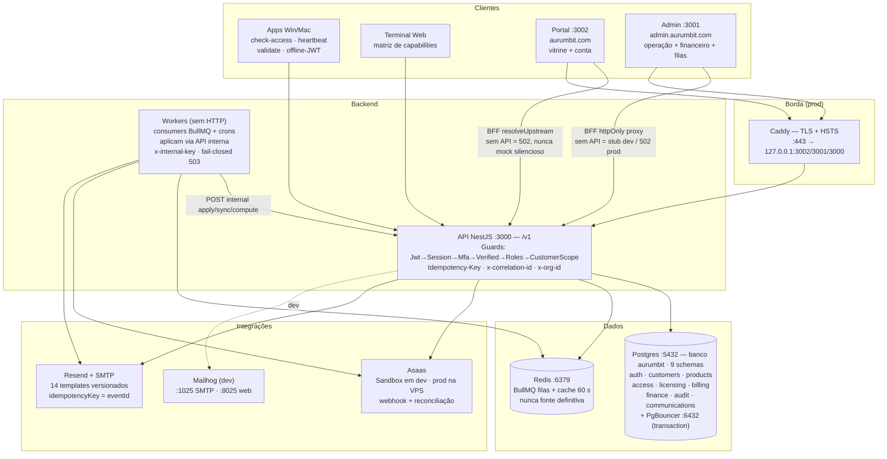

# Aurum Bit — Ecossistema de Produtos, Licenças e Cobranças

> Monólito modular NestJS · Postgres único `aurumbit` com 9 schemas por domínio (Fase 9) · Outbox + BullMQ/Redis · Asaas Sandbox-first · Resend transacional · Admin Next.js + Portal público

O Aurum Bit é a plataforma que vende, licencia, cobra e sustenta os produtos Aurum (Windows / Mac / Web / App). Este repositório contém **tudo que roda o negócio**: API, workers assíncronos, painel administrativo, portal público com área do cliente, banco único `aurumbit` com 9 schemas por domínio (roles por domínio, PgBouncer), deploy single-VPS com TLS e backup com restore testado.

**Estado (Fases 1–9):** Fases 1–7 entregues e verificadas por execução (builds PASS, e2e **42**). Fase 8 executada — modelo comercial licença × assinatura com gating por canal (unit API **464/464**, worker **5/5**, builds PASS, `prisma validate` 9/9; cerimônia operacional na VPS pendente). Fase 9 executada — consolidação `aurumbit` (1 banco, 9 schemas, roles por domínio, FKs RESTRICT, audit particionado, SecurityEvent, envelope de chave, CI 1 entrypoint, backup único; unit API **475/475**; relatório em `.planning/PHASE-9-REPORT.md`).

```text
Win / Mac / Web / App ──HTTPS──┐
Portal :3002 (vitrine+conta) ──┤
Admin  :3001 (operação) ──BFF───┼──► API NestJS :3000 (/v1) ──► Postgres `aurumbit` (9 schemas) + PgBouncer + Redis BullMQ
                                │         ▲                             ▲
                                │         │ x-internal-key              │ claim + publish
                                └─────────┴── Workers (sem HTTP: crons + DLQ + replay)
                                              ▲ Asaas (cobrança) · Resend (e-mail) · Caddy (TLS prod)
```

---

## Índice

1. [Visão e comportamento esperado](#1-visão-e-comportamento-esperado)
2. [Arquitetura — como tudo se relaciona](#2-arquitetura--como-tudo-se-relaciona)
3. [Monorepo — onde fica cada coisa](#3-monorepo--onde-fica-cada-coisa)
4. [Domínios e o banco único `aurumbit`](#4-domínios-e-o-banco-único-aurumbit-fase-9)
5. [Fluxos canônicos](#5-fluxos-canônicos-fim-a-fim)
6. [Modelo comercial — Fase 8](#6-modelo-comercial--fase-8-licença--assinatura--web-limitada)
7. [Segurança, LGPD e permissões](#7-segurança-lgpd-e-permissões)
8. [Eventos, filas e workers](#8-eventos-filas-e-workers)
9. [API — superfície](#9-api--superfície)
10. [Quickstart](#10-quickstart)
11. [Produção single-VPS](#11-produção-single-vps--fase-7)
12. [Testes e qualidade](#12-testes-e-qualidade)
13. [Jornada Fases 1–9 e roadmap 10](#13-jornada-fases-19-e-roadmap-10)
14. [Documentação](#14-documentação)

---

## 1. Visão e comportamento esperado

O sistema existe para responder três perguntas, sempre na mesma ordem de autoridade:

| Pergunta | Quem responde de verdade | O que a UI faz |
|---|---|---|
| `Posso usar?` | `GET /v1/access/check` + `POST /v1/access/check-batch` (server-side, cache 60 s com channel na chave) | Apenas reflete: libera, degrada ou bloqueia conforme a API |
| `Está pago?` | Billing (Asaas → webhook idempotente → reconciliação) + Finance (previsto / pendente / **realizado**) | Exibe fatura, status e extrato; nunca autoriza sozinha |
| `Está licenciado?` | Licensing (Entitlement é fonte da verdade, License guarda a chave) | Mostra `keyMasked`, revela só com MFA + auditoria |

**Comportamentos que nunca mudam:**

- **Sem cobrança, sem licença.** O checkout cria `Order → Invoice PENDING`; a licença só nasce no `PaymentConfirmed` real via `issueFromPayment` (claim-first por `eventId`). Não existe tela `done` sem cobrança.
- **Re-entrega não duplica.** Webhook repetido retorna `200 { duplicate: true }`. Segunda entrega do mesmo `eventId` nunca cria segunda licença, segunda transação ou segunda cobrança.
- **Fora de ordem não regride.** Evento antigo nunca tira um estado terminal (`CONFIRMED`, `REFUNDED`, `RECEBIDO`). Transição ilegal vira `REJECTED` + alerta, sem sobrescrever.
- **Offline tem teto.** Token offline vale `off_exp = min(iat + 7d, expires_at + 7d)`. Graça de 3 dias vence mesmo offline. Passou da graça → `DENY EXPIRED`; passou do `off_exp` → `DENY OFFLINE_EXPIRED`, exige online.
- **Saldo só anda via Transaction.** Previsto e pendente são projeção; só `Transaction` (INCOME/EXPENSE) muta saldo. Baixa repetida com o mesmo `Idempotency-Key`/`eventId` retorna o existente.
- **Financeiro é default-deny.** Sem `finance.read` explícito e escopado por organização, o backend responde `403` — mesmo que a UI seja burlada.

---

## 2. Arquitetura — como tudo se relaciona

### 2.1 Diagrama de runtime



### 2.2 Síncrono × assíncrono — a regra de ouro

- **Síncrono (request/response):** App/Portal/Admin falam REST com a API. Autenticação JWT 15 min + sessão (`sid ACTIVE`) + MFA step-up + `Verified` + `Roles` + `CustomerScope`. Toda escrita relevante aceita `Idempotency-Key`; todo request carrega `x-correlation-id` ecoado.
- **Assíncrono (fonte de verdade transacional):** o caso de uso escreve a mudança **e** a linha de `outbox_events` na **mesma transação** do seu banco de domínio. O relay (`SKIP LOCKED`, 30 s, 100 linhas) publica no BullMQ com `jobId = eventId` e marca `published`. Consumidores são idempotentes, com retry exponencial 5× e DLQ + replay auditado. **Workers nunca escrevem no Postgres direto** — aplicam via endpoints internos da API.
- **Redis nunca decide.** É fila + cache de leitura (60 s). Se cair, o sistema degrada leitura quente; nunca perde escrita.

### 2.3 Ciclo de vida de um request de escrita

```text
Cliente ──POST /v1/... + Idempotency-Key + x-correlation-id──► API
  │ 1. Guards (JWT→Session→MFA→Verified→Roles→Scope→Finance/License)
  │ 2. assertTransition(from,to) — ilegal = 422 + REJECTED + alerta
  │ 3. txn PG do domínio: escreve estado + outbox(eventId UNIQUE)
  │ 4. 200/201 imediato (ack de webhook Asaas < 2 s, sempre 200)
  ▼
Relay 30 s ──jobId=eventId──► BullMQ ──► Worker ──x-internal-key──► API interna
  │ fanout: access / licensing / finance / notifications — cada um idempotente
  ▼ DLQ em poison/404 · retry em 5xx/rede · replay manual auditado
```

---

## 3. Monorepo — onde fica cada coisa

```
apps/api/        NestJS, prefixo /v1 — negócio + webhooks + internos worker→API
apps/workers/    BullMQ consumers + crons + relay outbox — sem HTTP
apps/admin/      Next.js App Router :3001 — operação (dashboard, clientes,
                 cobranças, financeiro, auditoria, filas) via BFF httpOnly proxy-ou-mock
apps/portal/     Next.js :3002 — vitrine pública + área do cliente (conta,
                 sistemas, faturas, comprar, perfil) via BFF fail-closed
libs/            contracts · events · observability · security · database (9 clients)
                 asaas-adapter · resend-adapter · offline-token
prisma/          1 schema por domínio (auth…communications) no banco `aurumbit` — FKs intra-schema RESTRICT + exceção única documentada (ADR-006)
deploy/          compose base + override prod + Caddy + PgBouncer + init `aurumbit` (schemas+roles)
                 scripts migrate/seed/backup/smoke + obs + load
docs/            ARCHITECTURE.md (referência) · LGPD · SECURITY · SLOs
                 ADRs · RUNBOOKS · architecture-visual.html
.planning/       PROJECT · REQUIREMENTS · ROADMAP · STATE · ENDPOINTS-INVENTORY
                 PHASE-*-PLAN/REPORT (1–7 + plano da 8)
```

| Camada | Papel | Nunca faz |
|---|---|---|
| `apps/api` | Decide, valida, persiste, emite outbox | Nunca consome fila; nunca confia na UI para autorizar |
| `apps/workers` | Consome fila, reconcilia, agenda, envia e-mail | Nunca expõe HTTP; nunca escreve PG direto |
| `apps/admin` | Opera o negócio (suporte, financeiro, auditoria, DLQ) | Nunca autoriza sozinho — backend nega de verdade |
| `apps/portal` | Vende e atende o cliente final | Nunca exibe `done` sem licença; sem upstream, falha 502 |
| `libs/*` | Contratos, eventos, crypto, clients PG, adaptadores | Nunca guarda segredo; nunca cruza domínio via FK |
| `deploy/*` | Sobe, migra, semeia, protege, observa | Nunca commita `.env`; nunca expõe PG/Redis na WAN em prod |

---

## 4. Domínios e o banco único `aurumbit` (Fase 9)

Um Postgres, **1 banco `aurumbit` com 9 schemas isolados por role** (`auth customers products access licensing billing finance audit communications`, via PgBouncer `pool_mode=transaction`). Integridade: FKs intra-schema `ON DELETE RESTRICT` + **exceção única** `customers.identity_id → auth.user_identities`; demais referências cross-domínio são `String` opaca + evento (ADR-006).

| DB | Guarda | Fonte da verdade para |
|---|---|---|
| `auth` | Identidade, Credential hash-only, Session (family), Refresh, MFA, EmailVerification, ConsentGrant | Quem é e se pode entrar |
| `customers` | CustomerProfile PF/PJ, Organization, Membership (OWNER/ADMIN/FINANCE/MEMBER), Consents, GDPR | Quem compra e em nome de quem |
| `products` | Product, Version, Feature (+`channel`), Plan (+`billingInterval`), PlanFeature, catálogo imutável | O que é vendido e por quanto (preço congela por linha) |
| `access` | Contract (+itens com preço congelado), Entitlement (`priority` bonus 5 / contract 10 / subscription 20 / license 30), Bonus, Adjustment | **Se o uso é permitido** (`check-access`) |
| `licensing` | License (`key_hash` UNIQUE, `prefix/last4`, `key_enc` envelope via `LICENSE_MASTER_KEY_PATH`), Device (`device_hash` HMAC), offline-JWT (`ch`) | Chave, máquina e validade offline |
| `billing` | Asaas Customer espelho, Subscription/Invoice/Payment/Refund, WebhookReceipt `UNIQUE(provider,externalId)`, Outbox | Cobrança e seu estado |
| `finance` | Category, Account, Receivable, Payable, Transaction (**único que muta saldo**), ProjectionSnapshot (hash), Grant `finance.read` | Previsto / pendente / **realizado** |
| `audit` | AuditEvent append-only particionado por mês (sem UPDATE/DELETE), SecurityEvent (6 tipos), retenção 5a por `DETACH` | Quem fez o quê, quando, com qual motivo |
| `communications` | EmailMessage (`event_id` UNIQUE), sender, templates v1, receipts Resend | O que foi comunicado e se chegou |

Titularidade: **ambos** — PF global + Organização PJ opcional via Membership. Último OWNER é protegido. Vigência da licença **inicia na confirmação do pagamento**.

---

## 5. Fluxos canônicos fim a fim

### 5.1 Compra — do clique ao direito de uso

```text
Portal /dashboard/comprar ──POST checkout──► API createCheckoutOrder (PENDING, idempotente por orderId)
  │ polling PENDING (sem licença ainda)
  ▼ Asaas cobra (PIX/boleto/cartão)
Webhook Asaas ──POST /v1/billing/webhooks/asaas──► RECEIVED (ON CONFLICT → 200 duplicate)
  │ fila billing.webhook.apply ──► VALIDATED ──► APPLIED
  ▼ Payment CONFIRMED (paidAt + amount casando, fora-de-ordem não regride)
Outbox PaymentConfirmed ──fanout (jobId=eventId)──► Entitlement + License (licensing)
                                                   ├──► Receivable RECEBIDO + Transaction INCOME (finance)
                                                   └──► e-mail payment-confirmed (Resend, idempotencyKey=eventId)
Portal polling vê licença ──► tela done (só agora)
```

**Reconciliação fecha o laço:** hourly (pendentes < 7 d) + daily 03:00 America/Sao_Paulo (30 d) pagina a Asaas, compara `externalId → status` e injeta evento sintético `recon:<id>:<data>` pelo **mesmo pipeline**. Divergência de valor/estado → alerta + e-mail admin + métricas `billing.recon.*`.

### 5.2 Licença, device e offline

```text
Issue (plaintext 1×) → DB só key_hash + prefix/last4 + key_enc → API/UI só keyMasked (AURUM-••••-••••-AB12)
  │ link device: HMAC(secret, license||instance), limite com FOR UPDATE, 409 DEVICE_LIMIT
  │ rotate 15 min dual-accept · block · clone suspect (geo-IP só em memória, nunca GPS)
  ▼ validate online (sempre 200 no corpo allow/deny — evita retry-storm)
Offline-JWT: { lic_exp, grace_until, off_exp, ch, tv }
  now ≤ lic_exp e ≤ off_exp                          → ALLOW
  lic_exp < now ≤ grace_until e ≤ off_exp             → ALLOW degradado (banner, sem destrutiva)
  now > grace_until                                   → DENY EXPIRED (mesmo se ≤ off_exp)
  now > off_exp                                       → DENY OFFLINE_EXPIRED (exige online)
Renovação em graça mantém continuidade (starts_at = max(now, expires_anterior)).
Revogação = bump token_version (invalida JWTs + offline no próximo online).
Reveal = POST /v1/licenses/:id/reveal {reason} — license.read + MFA se admin + 10/h + audit license.reveal.
```

### 5.3 Financeiro — previsto, pendente, realizado

```text
PaymentConfirmed ──► Receivable RECEBIDO + Transaction INCOME (saldo +=)
PaymentFailed vencido ──► INADIMPLENTE · Refund ──► PAGO + EXPENSE (parcial/total)
Baixa manual (mark-received/mark-paid) ──► Transaction, idempotente por eventId/Idempotency-Key
Projeções: GET ?scope=monthly|quarterly|annual&ref=&tz= → HIT 200 · MISS leve 200 inline · MISS pesado 202 + jobId → GET jobs/:jobId
POST recompute (finance.manage) invalida + enfileira (jobId = scope:ref:hash) · TransactionPosted invalida snapshots do período
Automação: despesas via Asaas Bill Payments (boleto 47/convênio 48) + receitas com cobrança automática + sino in-system.
```

---

## 6. Modelo comercial — Fase 8 (licença × assinatura + web limitada)

Dois eixos ortogonais, ambos validados no servidor:

| Eixo | Valores | Onde vive | Regra |
|---|---|---|---|
| **Cobrança** | `ONE_TIME` (perpétuo desktop) · `MONTH` / `YEAR` (assinatura SaaS web) | `billingInterval` em Subscription/Invoice (invalido → 400) | Plano `ONE_TIME` gera licença `kind = lifetime` |
| **Canal** | `WEB` · `DESKTOP` · `BOTH` | `Feature.channel` + `Entitlement.channel` (default `BOTH`) + `ch` no offline-JWT | `check-access` filtra por channel; mismatch → `DENY CHANNEL_MISMATCH` |

```text
ONE_TIME ──► License kind=lifetime ──► expires_at null, grace null, sem expiração
             └── renew de lifetime → 409 LIFETIME_NO_RENEW · upgrade p/ lifetime OK
MONTH/YEAR ─► License expira calendário (starts_at = PaymentConfirmed, +1M/12M, grace +3d)
Channel: BOTH passa nos dois · WEB negado no DESKTOP (e vice-versa) · JWT antigo sem ch = BOTH + re-mint no próximo online
Cache do check-access inclui channel na chave (sem isso, ALLOW vazaria entre canais)
```

**Matriz que a web replica (sem nunca autorizar sozinha):** `portal/lib/capabilities.ts` espelha `WEB_*` × `DESKTOP_*` a partir da API para badges no checkout/dashboard. A UI indica; **a API decide**.

---

## 7. Segurança, LGPD e permissões

**Cadeia de guards (nesta ordem):** `Jwt (15 min) → Session (sid ACTIVE) → Mfa step-up → Verified → Roles → CustomerScope` + especializações `AdminStub (x-role) · FinanceRead (finance.read) · LicenseRead + RevealRateLimit (10/h) · x-internal-key (workers, fail-closed 503)`.

| Tema | Decisão vinculante |
|---|---|
| Papéis | `admin` total + MFA · `manager` operacional + `billing.read`, `finance.read` só por concessão explícita · `user` nunca `finance.*`, nunca `bonus.grant`/`license.adjust` |
| `finance.read` | Concessão exige `admin` + `organization_id` + motivo, registrada em Audit + Membership/RoleGrant. Default deny. Frontend oculta `/financeiro`; backend nega 403. Export segue a mesma guarda |
| Chaves | `AURUM-XXXX-XXXX-XXXX` (CSPRNG 128-bit). DB nunca plaintext: `key_hash` SHA256 UNIQUE + `prefix/last4` + `key_enc` AES-256-GCM/KMS. Logs nunca têm chave |
| IP / device / geo | IP só `ip_hash` HMAC (salt rotativo 90 d) + `/24` mascarado; raw só em memória; purge 90 d. `device_hash` = vida da licença + 12 meses. Sem GPS; geo-IP aproximada só em memória p/ `cloned_suspect` |
| Credenciais | Argon2id, refresh rotativo (reuso revoga a família), reset 60 min hash-only, lockout login, MFA TOTP obrigatório p/ admin/OWNER |
| Perímetro | helmet/CSP fail-closed, CORS sem `*`, CSRF no refresh same-origin, rate-limit login/webhook/reveal/recovery, segredos só env/KMS (`chmod 600`, nunca commit — `ADMIN_DEV_OPEN` jamais existe em prod) |
| Auditoria | Append-only particionado, 5 anos, sem UPDATE/DELETE. Reveal, grant financeiro, DLQ replay e baixa manual geram trilha com ator + motivo |
| LGPD | Consents versionados, `GET gdpr/export`, `POST gdpr/anonymize` (409 com vigência ativa), retenções: outbox 30 d · e-mail vars 90 d · sessão exp+30 d · logs 30 d — ver `docs/LGPD.md` |

---

## 8. Eventos, filas e workers

Padrão global: `jobId = eventId` (dedupe BullMQ), retry exponencial 5×, envelope inválido → DLQ direta, `removeOnComplete 1000 / removeOnFail 5000`.

| Fila | O que move | Ritmo |
|---|---|---|
| `licensing.evaluate` | tick → `POST /v1/access/admin/evaluate` (matriz ACTIVE→GRACE→EXPIRED) | repeat **5 min** |
| `licensing.sync` → `licensing.dlq` | outbox licensing/access | drenado pelo relay |
| `billing.webhook.apply` → `billing.dlq` | webhook Asaas + `recon:*` → `POST .../apply` interno | sob demanda |
| `billing.recon` | pendentes < 7 d + daily 30 d | repeat **1 h** + daily 03:00 SP |
| `billing.fanout` → `billing.fanout.dlq` | `billing.payment.confirmed.v1` → access / licensing / finance / notifications | sob demanda |
| `finance.sync` → `finance.dlq` | outbox billing → `POST /v1/finance/internal/sync` | sob demanda |
| `finance.projection.compute` → `finance.dlq` | `jobId = scope:ref:hash` → `POST .../internal/compute` (+ invalidação safety-net 60 min) | sob demanda + interval 60 min |
| `communications.send` | fanout `payment-confirmed` → Resend (`idempotencyKey = eventId`, template + versão) | sob demanda |
| outbox relay | `outbox_events` (claim 100 `FOR UPDATE SKIP LOCKED`) × 9 domínios + purge 30 d | interval **30 s** |

E-mails reais (14, versionados): `verify-email · reset-password · new-device-login · account-blocked · mfa-code · organization-invite · payment-confirmed/failed/overdue · subscription-cancelled · license-issued/expiring/renewed · bonus-granted`. Fora de escopo por decisão: `deposit-confirmed`, `withdrawal-confirm`, `order-filled` (resíduo wallet/crypto).

**DLQ replay:** `GET /v1/admin/dlq?queue=&page=` + `POST /v1/admin/dlq/:queue/replay {jobId}` (admin + MFA + audit) ou UI `/filas`. Replay preserva `jobId`/`eventId` — nunca duplica efeito.

---

## 9. API — superfície

Prefixo Nest **`/v1`** (exceções: `/health/*`, `/webhooks/resend`, `/metrics`). BFF Next (`apps/admin/app/api/**`, `apps/portal/app/api/**`): faz **proxy** com sessão httpOnly quando `API_INTERNAL_URL` está definido; em dev cai em stub tipado; em prod falha **502 fail-closed** (nunca mock silencioso — coberto por teste negativo que derruba a API e exige degradação visível).

Inventário completo e auditado por leitura direta do código: [`.planning/ENDPOINTS-INVENTORY.md`](.planning/ENDPOINTS-INVENTORY.md) (~145 endpoints Nest + ~28 rotas BFF + 11 queues; ver o arquivo como fonte canônica).

| Domínio | Rotas (resumo) |
|---|---|
| Auth (15) | `register · verify-email · resend-verification · login (ticket MFA) · refresh (rotação) · logout · sessions lista/revoga · forgot/reset · change-password · mfa/enroll+verify` |
| Access (14) | `check + check-batch ≤ 50` (público server-to-server) · admin: contracts, items, entitlements upsert, `bonus` grant/revoke, adjustments, `admin/evaluate` |
| Customers (13) | `me GET/PATCH · upgrade-to-pj · organizations + members (invite/update/remove) · consents · gdpr/export+anonymize` |
| Products/Plans/Features (11) | products + versions + archive · plans (cria + archive, **sem update de preço**) · features lista/cria |
| Licensing (15 + 12 flow) | issue (1×) / get / renew / suspend / resume / revoke / **reveal auditado** · devices link/unlink/rotate/block/validate · `GET :id/offline-token` + `POST offline/check` |
| Billing (25) | customers/sync · invoices + subscriptions + payments + refunds (Idempotency-Key) · `webhooks/asaas` (token timing-safe, sempre 200) + `apply`/`recon-apply` internos |
| Finance (33) | overview · categories/accounts · receivables/payables + `mark-received/mark-paid` · transactions · balance · projections (hit 200 / miss 202+jobId) + `recompute` · `grants finance.read` · expenses + auto-charge + notifications · `internal/sync` |
| Comms + Health + Audit | `POST /webhooks/resend` (Svix, sempre 200) · `GET /health/live` (sempre 200) + `/health/ready` (PG+Redis+DLQ warn, nunca 503 por DLQ) · audit via BFF |
| Admin/ops | DLQ paginado + replay · retenção dry-run · `/metrics` (`http_requests_total`) + correlation Outbox→BullMQ→Resend→Audit |

---

## 10. Quickstart

### 10.1 Local (5 min, requer Docker ativo)

```bash
cp .env.example .env
docker compose -f deploy/docker-compose.yml up --build -d
bash deploy/scripts/migrate-all.sh     # 9 domínios
bash deploy/scripts/seed-all.sh
curl -f http://localhost:3000/health/live    # 200 {status:ok}
curl -f http://localhost:3000/health/ready    # 200 {postgres:up,redis:up,dlq}
```

| Serviço | URL | O quê |
|---|---|---|
| API | http://localhost:3000/v1 · `/health/*` · `/metrics` | negócio + webhooks + internos |
| Admin | http://localhost:3001 | dashboard, clientes, cobranças, financeiro, auditoria, filas |
| Portal | http://localhost:3002 | vitrine + área do cliente |
| Mailhog | http://localhost:8025 | e-mails locais (SMTP :1025) |
| Postgres | localhost:5432 (banco `aurumbit`, 9 schemas) + PgBouncer :6432 | `auth…communications` |
| Redis | localhost:6379 | filas + cache 60 s |

### 10.2 Comandos do dia a dia

```bash
pnpm build / pnpm lint / pnpm typecheck          # turbo (ou turbo run <task>)
npm --prefix apps/api run build && npm --prefix apps/api run test
npm --prefix apps/api run test:e2e
npm --prefix apps/workers run build && npm --prefix apps/admin run build
node deploy/load/smoke.js --base http://localhost:3000
bash deploy/scripts/backup-check.sh              # exige 1 DB aurumbit + 9 schemas
bash deploy/scripts/clone-ready-timer.sh --dry-run
```

> `NEXT_PUBLIC_*` é assada no `next build` — trocar valor exige rebuild + redeploy. Build de prod sempre no Linux (CI/VPS), nunca no Windows.

---

## 11. Produção single-VPS — Fase 7

Um compose, três hosts, zero porta na WAN:

```text
Internet ──443──► Caddy (TLS + HSTS + www→apex)
  ├── aurumbit.com       → 127.0.0.1:3002 (portal)
  ├── admin.aurumbit.com → 127.0.0.1:3001 (admin)
  └── api.aurumbit.com   → 127.0.0.1:3000 (api)
postgres→migrate(one-shot 9 domínios)→api→portal · workers após migrate · mailhog só com --profile dev
```

```bash
docker compose -f deploy/docker-compose.yml -f deploy/docker-compose.prod.yml up -d --build
bash deploy/scripts/gen-prod-env.sh      # gera .env.prod (chmod 600, nunca commitado)
bash deploy/scripts/seed-prod.sh         # admin + grant + catálogo (upserts idempotentes)
bash deploy/scripts/smoke-prod.sh        # 8 checks TAP (webhook duplicado incluso)
bash deploy/scripts/pg-backup.sh         # dump cifrado + rclone off-VPS + retenção 14 d
bash deploy/scripts/pg-restore-probe.sh  # restaura restore_probe_aurumbit e checa 9 schemas + contagens
```

**Gates antes do corte de DNS:** TTL 300 com 24–48 h de antecedência, SPF/DKIM/DMARC da Resend, `curl --resolve` verde na VPS, primeira cobrança em valor mínimo com estorno, `LICENSE_MASTER_KEY_PATH` (arquivo 0600 via volume) com cópia cifrada off-VPS **antes** da primeira licença (perdê-la é irreversível), purge só com restore recorrente verde. Rollback: tag SHA anterior + reload Caddy + `up -d` + rollback DNS (minutos). Runbook executável por terceiro: [`docs/RUNBOOKS/deploy.md`](docs/RUNBOOKS/deploy.md).

---

## 12. Testes e qualidade

| Gate | Resultado verificado |
|---|---|
| Builds `api` + `workers` + `admin` + `portal (tsc)` | PASS |
| Unit API | **464/464** (47 suites; baseline 429 da Fase 7 preservada, +35 da Fase 8, zero regressão) |
| Worker | **5/5** (node:test `licensing.issue`: issue → duplicate, DLQ, retry) |
| E2E API | **42/42** preservados (licensing, offline, billing, finance flows) |
| Infra como código | `bash -n` 15/15 · `compose config` + validação semântica (loopback, depends, restart, mem) · `prisma validate` 9/9 no CI |
| Tracer Fase 7 (T0) | Vitrine via API + teste negativo anti-mock (sem API → 502 visível) |
| Tracer Fase 8 (T0) | `ONE_TIME` fim a fim: checkout PENDING → confirmado 2× mesmo `eventId` → 1 licença `lifetime` → `DESKTOP ALLOW` / `WEB CHANNEL_MISMATCH` → 2ª entrega DUPLICATE |

Qualidade contínua: `lint → typecheck → test → build → prisma validate (9) → e2e → smoke local → smoke prod` + jobs CI (`prod-config`, `clone-ready` nightly, `secrets`/gitleaks). Incidente registrado com transparência no `PHASE-7-REPORT.md` (`.env` local vazou em output de auditoria — sem repo git, sem risco de commit; rotação recomendada se compartilhado).

---

## 13. Jornada Fases 1–9 e roadmap 10

| Fase | Entrega | Status |
|---|---|---|
| 1 — Fundação | Monorepo pnpm+turbo, Nest stub, 9 schemas, compose 6 serviços, CI, observabilidade base | ✅ concluída (runtime < 10 min herdado p/ Fase 7) |
| 2 — Identidade e acesso | Auth completa, customers PF/PJ, products+access base, guards Jwt→…→CustomerScope, admin shell | ✅ 28 unit + 20 e2e |
| 3 — Licenciamento | Licenses + devices + offline 7 d + chaves hash/masked/reveal + evaluator 5 min | ✅ 137 unit + 30 e2e |
| 4 — Faturamento | Asaas Sandbox-first, webhook idempotente + reconciliação, outbox/BullMQ, Resend 14 templates | ✅ 275 unit + 35 e2e |
| 5 — Financeiro | Previsto/pendente/realizado, projeções hit/miss/202, sync billing→finance, `finance.read` escopado | ✅ 326 unit + 42 e2e |
| 6 — Robustez | DLQ replay, retenção, backup-check, ready warn, helmet/CSP, GDPR real, `/metrics`, smoke | ✅ 377 unit + 42 e2e + ARCHITECTURE + README |
| 7 — Produção VPS | Portal no compose, override prod loopback, Caddy TLS, `.env` prod, seed real, backup DR + probe + dead-man, smoke prod, runbook, clone→ready | ✅ código verificado localmente; up real + reboot + monitores na VPS pendentes |
| 8 — Modelo comercial | `billingInterval` + `kind=lifetime` + channel WEB/DESKTOP + gating server-side + checkout real + catálogo `ONE_TIME` + BFF fail-closed total | ✅ executada (código verificado; cerimônia VPS pendente — plano ONE_TIME ativo + compra mínima) |
| 9 — Consolidação `aurumbit` | 1 banco + 9 schemas, roles por domínio, FKs RESTRICT + exceção única, audit particionado, SecurityEvent, envelope de chave, CI 1 entrypoint, backup único | ✅ executada (`.planning/PHASE-9-REPORT.md`; unit 475/475; gates vivos na VPS/CI pendentes) |
| 10 — Sync offline-first | `SYNC-PROTOCOL.md` (pull cursorado + push idempotente, tombstones, LWW), `SyncCursor`, piloto 1 entidade, motor desktop, `sync_lag_*` | ⏳ por último (depende de 8–9) |

---

## 14. Documentação

- **Arquitetura (leia primeiro):** [`docs/ARCHITECTURE.md`](docs/ARCHITECTURE.md) · visual interativo `docs/architecture-interactive.html` · inventário [`.planning/ENDPOINTS-INVENTORY.md`](.planning/ENDPOINTS-INVENTORY.md)
- **Decisões:** [`.planning/PROJECT.md`](.planning/PROJECT.md) §§1–6 (offline, chaves, `finance.read`, IP/device/geo, idempotência, templates) · `docs/ADR-00{1,2,3,4,5}.md`
- **Operação:** [`docs/RUNBOOKS/deploy.md`](docs/RUNBOOKS/deploy.md) · `env-prod.md` · `auth/billing/finance/licensing/health/correlation/webhook-replay/clone-ready.md`
- **Compliance:** [`docs/LGPD.md`](docs/LGPD.md) · [`docs/SECURITY.md`](docs/SECURITY.md) · [`docs/SLOs.md`](docs/SLOs.md)
- **Histórico:** [`.planning/PHASE-1-REPORT.md`](.planning/PHASE-1-REPORT.md) … `PHASE-7-REPORT.md` · [`ROADMAP.md`](.planning/ROADMAP.md) · [`STATE.md`](.planning/STATE.md) · [`REQUIREMENTS.md`](.planning/REQUIREMENTS.md)

---

Feito com rigor GSD: planejar → delegar a especialistas → verificar com execução → consolidar. Próximo passo real: subir a VPS e rodar o runbook de deploy do zero ao verde.
