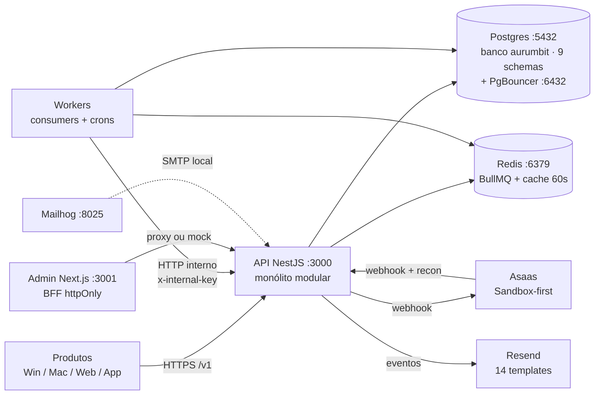
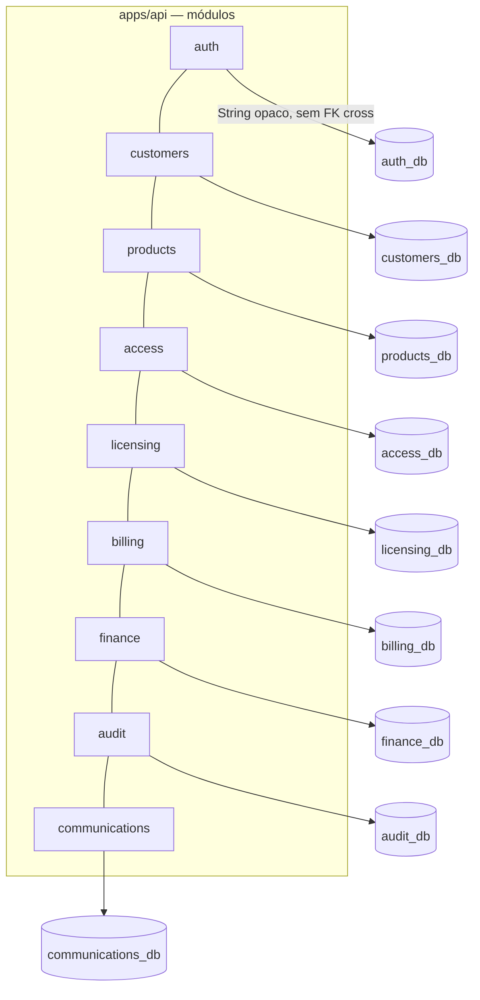
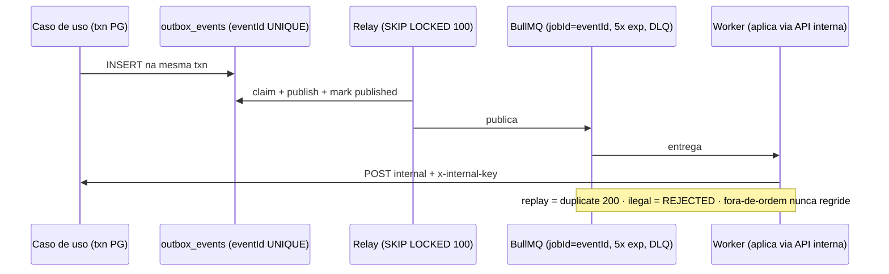
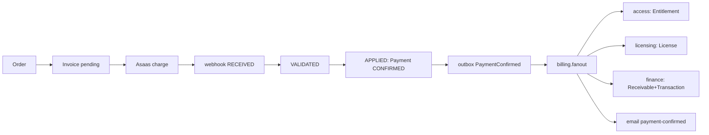
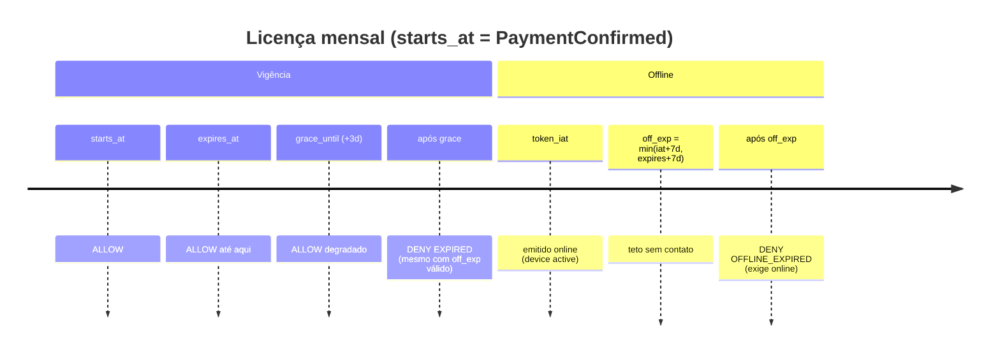
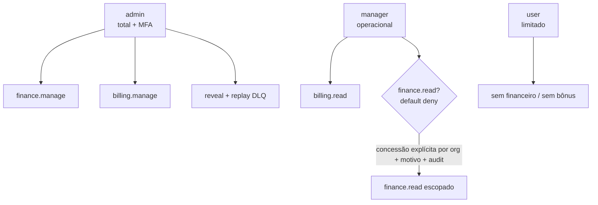

# Aurum Bit — Demonstrativo Visual da Arquitetura

> Versão renderizável: abra `docs/architecture-visual.html` no navegador. Diagramas como código (Mermaid) abaixo.

## 1. Visão de sistema (contexto)

## 2. Contêineres e bancos por domínio

## 3. Comunicação assíncrona (Outbox + BullMQ)

## 4. Fluxo canônico de compra

## 5. Licença: validade × graça × offline

## 6. Papéis e finance.read escopado

## 7. Legenda de filas e crons

| Fila | Gatilho | DLQ |
|---|---|---|
| licensing.evaluate | repeat 5min | log |
| licensing.sync | outbox | licensing.dlq |
| billing.webhook.apply | webhook/recon | billing.dlq |
| billing.recon | 1h + daily 03:00 SP | log |
| billing.fanout | PaymentConfirmed | billing.fanout.dlq |
| finance.sync | outbox billing | finance.dlq |
| finance.projection.compute | 202/recompute | finance.dlq |
| comm.email.send | fanout | comm.email.dlq |
| outbox relay | 30s × 9 schemas | — |
